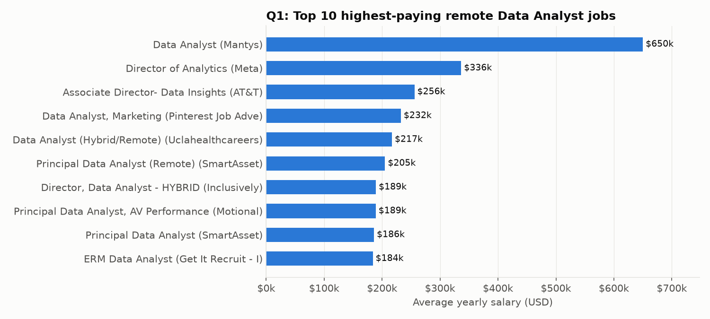
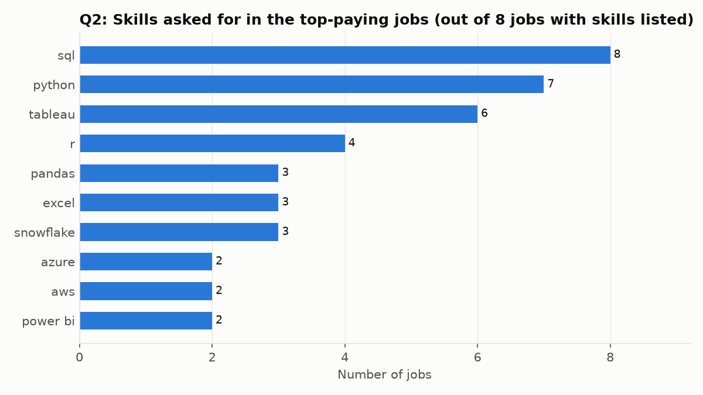
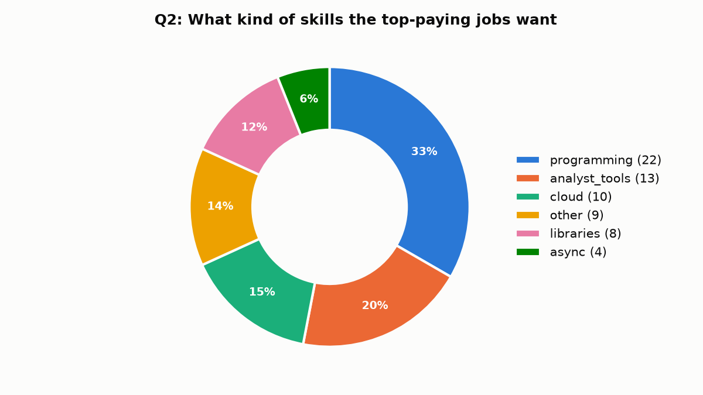
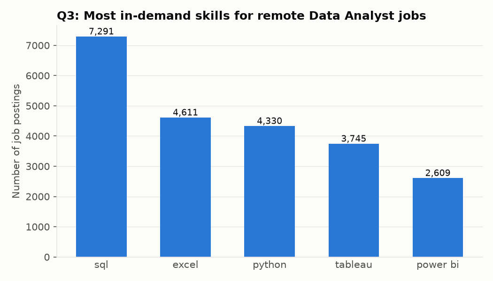
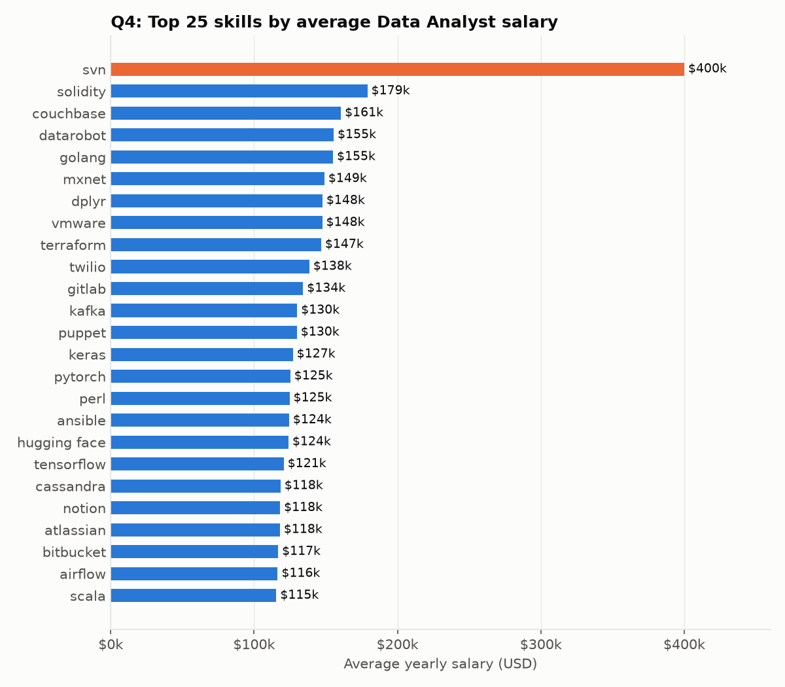
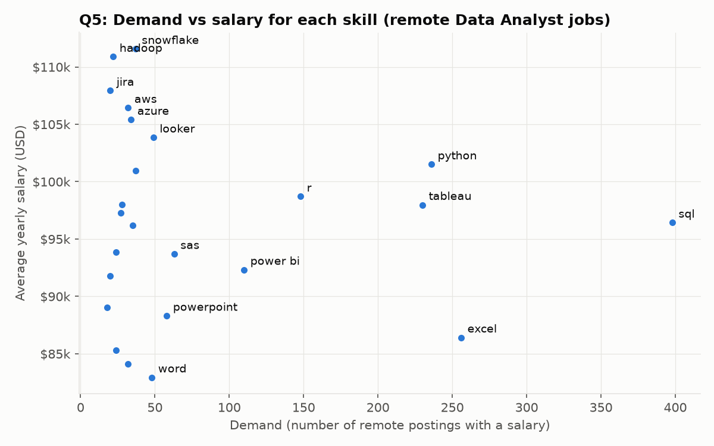

# Job Postings Facts: SQL Data Analytics Project

I used SQL to explore ~788k real job postings from 2023 and answer one question: **if you want a Data Analyst job (especially a remote one), which skills pay the most and which are asked for the most?**

Everything is written in PostgreSQL. The dataset and question ideas come from Luke Barousse's *SQL for Data Analytics* course on YouTube. I wrote and ran the queries myself, then exported the results and made the charts below.

## The data

There are four tables in a simple star schema: one fact table in the middle, with dimension tables around it.

| Table | What's in it | Rows |
|---|---|---|
| `job_postings_fact` | One row per job posting: title, location, remote or not, salary, date | 787,686 |
| `company_dim` | Company name and links | 140,033 |
| `skills_dim` | Skill name and its type (programming, cloud, analyst_tools...) | 259 |
| `skills_job_dim` | Which skills each job asks for (a job-to-skill bridge table) | 3,669,604 |

```
company_dim ──< job_postings_fact ──< skills_job_dim >── skills_dim
```

## Questions and what I found

### Q1: What are the top-paying remote Data Analyst jobs?
File: [`top_paying_jobs_q1.sql`](top_paying_jobs_q1.sql)

I filtered to Data Analyst jobs with location "Anywhere" and a listed salary, sorted by salary, and kept the top 10.



- Salaries in the top 10 range from **$184k to $650k**.
- The $650k Mantys posting looks like an outlier, probably a data entry mistake. Without it the top is $336k (Director of Analytics, Meta).
- Most of these are senior titles (Director, Principal, Associate Director), not entry-level "Data Analyst" roles.

### Q2: What skills do those top-paying jobs ask for?
File: [`skills_for_top_jobs_q2.sql`](skills_for_top_jobs_q2.sql)

I took the top 10 jobs from Q1 in a CTE and joined them to the skills tables. Only 8 of the 10 have skills listed.





- **SQL is in all 8** jobs, Python in 7, Tableau in 6.
- One third of the skills asked for are programming languages. Next come analyst tools (Excel, Tableau, Power BI) and cloud (Snowflake, Azure, AWS).

### Q3: What are the most in-demand skills for remote Data Analysts?
File: [`optimal_skills_q3.sql`](optimal_skills_q3.sql)

This counts how often each skill appears across all remote Data Analyst postings and keeps the top 5.



- SQL is far ahead (7,291 postings), followed by Excel, Python, Tableau and Power BI.
- So the basic toolkit is SQL plus Excel plus one programming language plus one BI tool.

### Q4: Which skills are linked to the highest salaries?
File: [`skills_by_avg_salary_q4.sql`](skills_by_avg_salary_q4.sql)

This takes the average salary for each skill across Data Analyst jobs that list a salary, top 25.



- **svn ($400k)** comes from just **1 posting**, so I'd ignore it.
- The rest of the list is mostly engineering-side skills: cloud and devops (Terraform, GitLab, Kafka, Airflow) and ML (PyTorch, Keras, TensorFlow). Analysts who can also handle data engineering or ML get paid more.
- This query doesn't count how many postings each skill has, so rare skills can rank high. That's why Q5 combines demand and salary.

### Q5: Which skills are both in demand and well paid (the "optimal" skills)?
File: [`skill_demand_q5.sql`](skill_demand_q5.sql)

There are two CTEs, one for demand count and one for average salary per skill. I joined them and sorted by demand first.



- **SQL and Python** sit in the best spot: high demand and ~$96-102k average.
- **Excel** is in high demand but pays less (~$86k). It's needed, but it won't get you a higher salary by itself.
- Cloud tools (**Snowflake, AWS, Azure**) and **Looker** pay $104-112k with lower demand. These are good skills to add once the basics are covered.
- Small things I noticed: `sas` shows up twice because it has two skill IDs in `skills_dim`, and the salary CTE doesn't filter for remote jobs (I left a comment in the file about this).

## Overall takeaways

1. Learn **SQL first**. It's the most asked-for skill, and every top-paying job wants it.
2. Then **Python** and one **BI tool** (Tableau or Power BI).
3. To earn more, add **cloud** skills (Snowflake, AWS, Azure).
4. Be careful with averages built on just a few postings, like the svn result (1 posting) and the $650k job.

## How to run it

You need PostgreSQL (I used v18) and the four CSV files from the course.

```bash
# 1. create the database
psql -d postgres -f sql_load/1_create_database.sql

# 2. create the tables
psql -d sql_course -f sql_load/2_create_tables.sql

# 3. load the CSVs (edit the file paths inside this script to where your CSVs are)
psql -d sql_course -f sql_load/3_modify_tables.sql

# 4. run any question
psql -d sql_course -f top_paying_jobs_q1.sql
```

The CSVs are too big for GitHub (job_postings_fact.csv is ~130 MB), so they're not in this repo. The query outputs I got are saved in [`results/`](results/) and the charts in [`charts/`](charts/).

## Files

```
sql_load/                     setup scripts (database, tables, CSV load)
top_paying_jobs_q1.sql        Q1
skills_for_top_jobs_q2.sql    Q2
optimal_skills_q3.sql         Q3
skills_by_avg_salary_q4.sql   Q4
skill_demand_q5.sql           Q5
results/                      query outputs as CSV
charts/                       charts used in this README
```

Tools: PostgreSQL, psql, VS Code. Charts made in Python (pandas and matplotlib) from the exported results.
